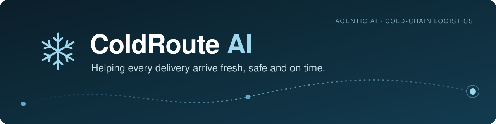
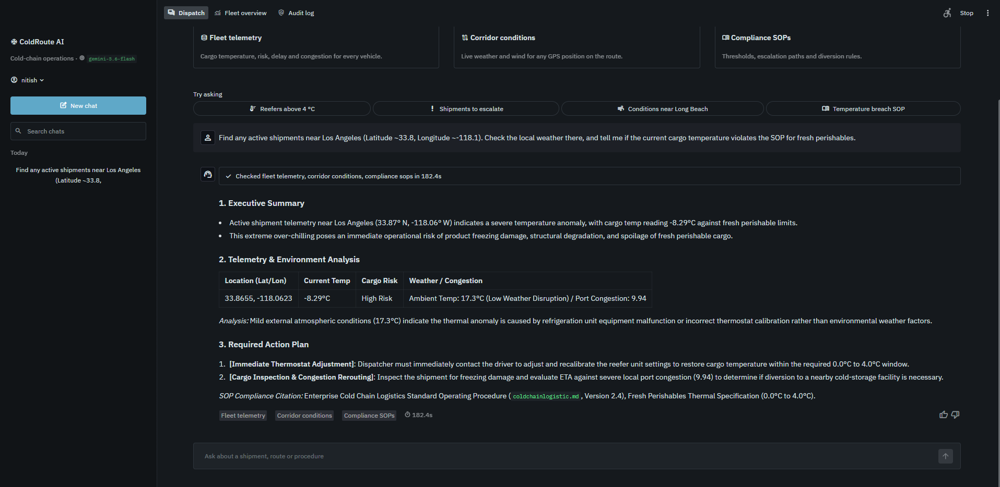
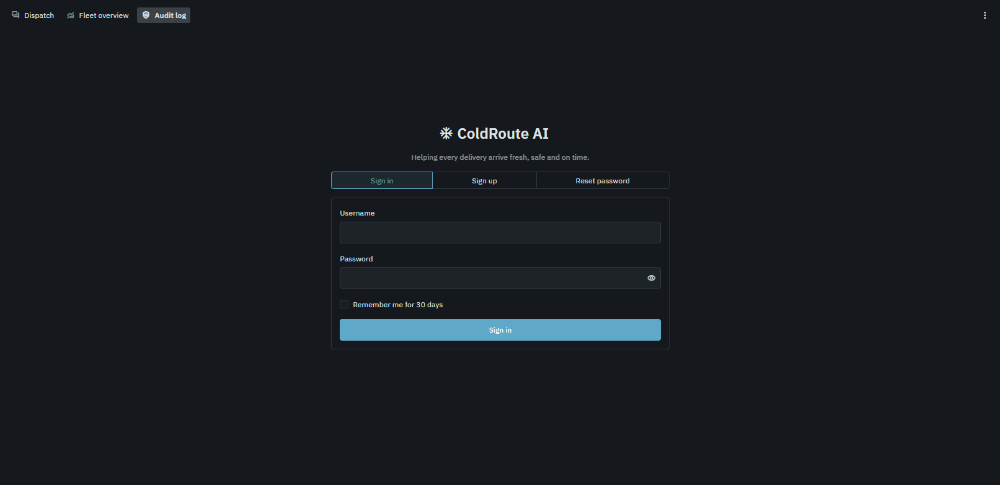
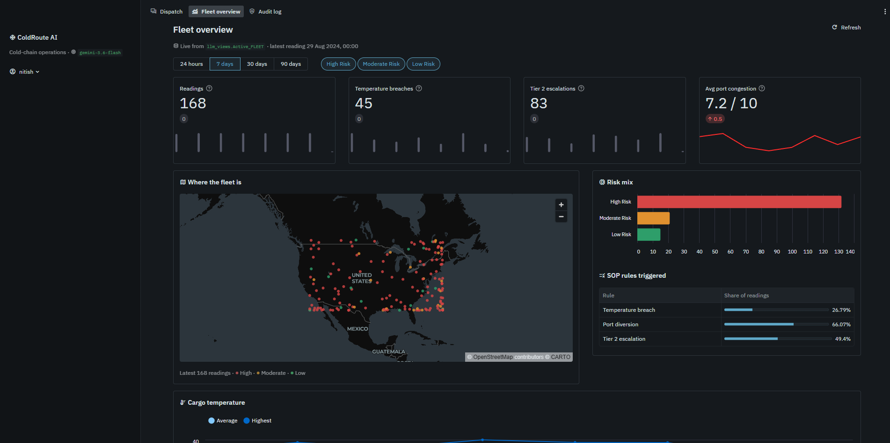
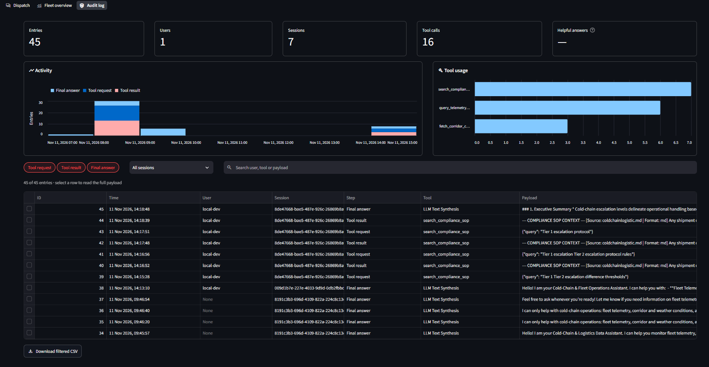
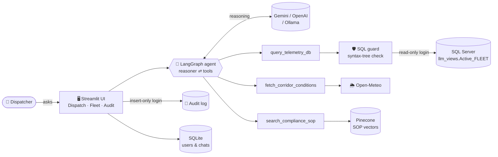

<div align="center">



<br/>

**An AI agent that lets cold-chain dispatchers *chat with their fleet*: live telemetry, corridor weather and compliance SOPs in one conversation.**

<br/>


[**Features**](#-key-features) &nbsp;•&nbsp;
[**Architecture**](#-architecture) &nbsp;•&nbsp;
[**Security**](#-security-design) &nbsp;•&nbsp;
[**Quick start**](#-quick-start) &nbsp;•&nbsp;
[**Tech stack**](#-tech-stack)

</div>

---

## The problem

Temperature-sensitive goods such as fresh food, vaccines and medicines are lost when a truck runs a few degrees too warm or gets stuck at a congested port. To act in time, a dispatcher has to check three separate sources:

<table>
<tr>
<td width="33%" valign="top">

### 📡 Telemetry
Where is each truck? How cold is the cargo? How risky is the route?

</td>
<td width="33%" valign="top">

###  Conditions
Is weather about to disrupt the corridor?

</td>
<td width="33%" valign="top">

###  Policy
What does the SOP (Standard Operating Procedure) require when a threshold is breached?

</td>
</tr>
</table>

**ColdRoute AI combines all three in a single chat.** Ask *"Which shipments need a Tier 2 escalation, and is the weather near them getting worse?"* and the agent queries the database, checks live weather, looks up the SOP, and gives an answer backed by evidence, showing every step it took.

> [!NOTE]
> This is built the way a **production** AI system should be: the LLM never touches the database directly, every generated query is validated, database logins have only the permissions they need, and every action is recorded in an audit log.

---

##  Screenshots

<div align="center">



<sub><b>Dispatch:</b> ask in plain English; expand each step to see the exact SQL, weather data or SOP passage behind the answer.</sub>

<br/><br/>

<table>
<tr>
<td width="33%" align="center"><br/><sub><b>Sign in / Sign up</b></sub></td>
<td width="33%" align="center"><br/><sub><b>Fleet overview</b></sub></td>
<td width="33%" align="center"><br/><sub><b>Audit log (admin)</b></sub></td>
</tr>
</table>

</div>

---

##  Key features

<table>
<tr>
<td width="50%" valign="top">

###  Agentic chat
- A **LangGraph** reasoning loop picks which tools to call, in what order, and when it has enough evidence to answer
- **Transparent steps**: SQL with its results table, weather location on a map, retrieved SOP passages
- Chat history per user: **search, rename, delete, export to Markdown**
- 👍 / 👎 feedback and response time on every answer
- **Guardrails**: refuses off-topic requests and attempts to change its role

</td>
<td width="50%" valign="top">

###  Fleet overview
- KPI cards, a **risk-coloured fleet map**, risk breakdown and temperature trend
- **"Needs attention"** table that applies the SOP rules automatically:
  -  cargo above **4 °C**: temperature breach
  -  port congestion above **7**: divert
  -  *High Risk* **and** delay probability above **0.65**: Tier 2 escalation
- Falls back to the CSV dataset if the database is unreachable

</td>
</tr>
<tr>
<td width="50%" valign="top">

### Audit log
- Every tool request, tool result and answer is logged with user and session
- Activity timeline, tool-usage chart, filters, search, full payload view
- **CSV export**; visible to **admins only**

</td>
<td width="50%" valign="top">

###  Swap any model
- **LLM**: Gemini, OpenAI GPT-4o, or fully local **Ollama**, chosen with one setting
- **Embeddings**: local Hugging Face (Qwen3), Gemini or OpenAI
- Each embedding provider gets its own Pinecone index, so vectors from different models never mix

</td>
</tr>
</table>

###  The agent's three tools

| Tool | Source | What it does |
|:--|:--|:--|
| `query_telemetry_db` | SQL Server | Runs a **validated, read-only** T-SQL `SELECT` on the fleet telemetry view |
| `fetch_corridor_conditions` | Open-Meteo API | Fetches live weather for GPS coordinates and rates disruption as **Low / Moderate / High** |
| `search_compliance_sop` | Pinecone | **Semantic search (RAG)** over SOP documents: thresholds, breach handling, rerouting rules |

---

##  Architecture



<details>
<summary><b> How a single question is answered, step by step</b></summary>
<br/>

1. The user asks a question in **Dispatch**.
2. The **reasoner** node sends the conversation and a strict system prompt to the LLM, which can call tools.
3. If the LLM requests a tool, the **ToolNode** runs it. SQL first passes through the **SQL guard**, then runs under a read-only database login.
4. The tool result goes back to the reasoner, and the loop repeats until the model writes a final answer.
5. Each step is streamed live to the UI and written to the **audit log**.

</details>

---

##  Security design

> [!IMPORTANT]
> **Defence in depth:** letting an LLM write SQL is risky, so several independent layers protect the data. Even if one fails, the others still hold.

 Layer | Protection |
:--|:--|
 **Prompt scope** | Limits the agent to cold-chain topics and tells it to ignore requests to change its role |
 **SQL guard** · [`sql_guard.py`](src/sql_guard.py) | Parses each query into a syntax tree and allows **one `SELECT` only**. Blocks `INSERT`, `UPDATE`, `DELETE`, `MERGE`, `DROP`, `EXEC` and `SELECT INTO`, and allows only the approved view |
 **View abstraction** | The agent never sees the raw table, only a clean view with renamed columns |
 **Least-privilege logins** · [`security.sql`](scripts/security.sql) | Three separate SQL logins: **agent** (read the view), **audit writer** (insert only), **audit reader** (read the log only). The script ends by checking every permission |
 **Tamper-resistant audit** | The process that writes the log cannot read, change or delete it |
 **Query limits** | Query timeout, at most 5,000 rows fetched, 10 preview rows sent to the LLM |
 **Authentication** | Salted **scrypt** password hashes, constant-time comparison, protection against discovering usernames by timing |
 **Authorization** | Audit page for admins only; each chat can be opened only by its owner |
 **Secrets** | All credentials in `.env`, which git ignores; template in `.env.example` |

---

##  Tech stack

| Layer | Technology |
|:--|:--|
|  **Agent orchestration** | LangGraph · LangChain |
|  **LLMs** | Google Gemini · OpenAI GPT-4o · Ollama (local) |
|  **Retrieval (RAG)** | Pinecone · sentence-transformers (Qwen3-Embedding) · Gemini / OpenAI embeddings |
|  **Data** | Microsoft SQL Server · SQLAlchemy · pyodbc · SQLite |
|  **SQL safety** | sqlglot (T-SQL parsing into a syntax tree) |
|  **External API** | Open-Meteo (live weather) |
|  **Frontend** | Streamlit multipage app · Altair charts · maps |
|  **Processing** | pandas · pypdf · openpyxl |
|  **CI/CD** | GitHub Actions → AWS EC2 (SSH) · systemd · uv |

---

##  Quick start

> [!TIP]
> **Prerequisites:** Python 3.10+, SQL Server with **ODBC Driver 18**, a free **Pinecone** account, and one LLM option: a Gemini key, an OpenAI key, or **Ollama** running locally.

**1. Clone and install**
```bash
git clone https://github.com/initishkumaryadav/Agentic.git
cd Agentic
python -m venv .venv
.venv\Scripts\activate          

pip install -r requirements.txt
```

**2. Configure:** copy the template, then fill in your database details and API keys ([all settings](#-configuration))
```bash
cp .env.example .env
```

**3. Load the data into SQL Server**
```bash
python scripts/ingest_data.py
```
Then open [`scripts/security.sql`](scripts/security.sql) in SSMS or Azure Data Studio, enter new passwords in **STEP 1**, and run the whole file. It creates the view, the audit table and the three logins, then checks their permissions.

**4. Index the SOP documents in Pinecone** (only changed files are re-uploaded)
```bash
python scripts/ingest_sop_pinecone.py
```

**5. Run** 
```bash
streamlit run src/frontend.py
```
Open **http://localhost:8501**, choose **Sign up**, and create your account.

> [!NOTE]
> The **first account** created becomes the **admin** and can see the Audit log. Set `ALLOW_SIGNUP=false` once your team is registered.
> To try the agent without the UI, run `python src/orchestrator.py` for a terminal chat.

---

## Configuration

<details>
<summary><b>All <code>.env</code> settings</b> (click to expand)</summary>
<br/>

| Variable | Purpose | Example |
|:--|:--|:--|
| `SQL_SERVER_HOST` · `SQL_SERVER_PORT` · `DB_NAME` | SQL Server connection | `localhost` · `1433` |
| `SQL_AGENT_USER` / `_PASSWORD` | Read-only login used by the agent | `llmagent` |
| `SQL_AUDIT_USER` / `_PASSWORD` | Insert-only audit writer | `jailogic` |
| `SQL_AUDIT_READER_USER` / `_PASSWORD` | Read-only audit reader (Audit page) | `fde_audit_reader` |
| `SQL_ADMIN_USER` / `_PASSWORD` | Used only by `ingest_data.py` | `sa` |
| `SQL_QUERY_TIMEOUT` | Per-query timeout in seconds | `30` |
| `Agent_llm` | `GEMINI`, `OPENAI` or `OLLAMA` | `GEMINI` |
| `GEMINI_API_KEY` · `GEMINI_MODEL` | Gemini settings | `gemini-3.6-flash` |
| `OPENAI_API_KEY` | OpenAI settings | |
| `OLLAMA_MODEL` · `OLLAMA_BASE_URL` | Local model | `qwen2.5:0.5b` |
| `PINECONE_API_KEY` | Vector database | |
| `Embeddings_model` | `LOCAL`, `GEMINI` or `OPENAI` | `LOCAL` |
| `Local_Embedding_Model` | Hugging Face model for `LOCAL` | `Qwen/Qwen3-Embedding-4B` |
| `EMBEDDING_DEVICE` | `auto`, `cpu` or `cuda` | `auto` |
| `ALLOW_SIGNUP` | `false` turns off new registrations | `true` |

</details>

---

##  Project structure

<details>
<summary><b>Folder layout</b> (click to expand)</summary>
<br/>

```
.
├── src/
│   ├── frontend.py             # Entry point: sign in / sign up, navigation, sidebar
│   ├── orchestrator.py         # LangGraph agent (reasoner ⇄ tools), LLM selection
│   ├── tools.py                # The 3 agent tools + embedding / Pinecone setup
│   ├── sql_guard.py            # Allows only read-only SELECT on the approved view
│   ├── auth_store.py           # User accounts, scrypt password hashing
│   ├── chat_store.py           # SQLite chat sessions, messages, feedback
│   ├── ui_common.py            # DB connections, audit writer, SOP rules, helpers
│   ├── Prompt/systemPrompt.txt # Agent instructions and scope rules
│   └── app_pages/
│       ├── dispatch.py         # Chat UI with live agent steps
│       ├── fleet.py            # Fleet overview dashboard
│       └── audit.py            # Admin audit log
├── scripts/
│   ├── ingest_data.py          # CSV → SQL Server (dbo.RAW_DATA)
│   ├── ingest_sop_pinecone.py  # Chunks and embeds SOP docs into Pinecone
│   ├── security.sql            # View, audit table, least-privilege logins + checks
│   └── install_odbc_driver.sh  # ODBC Driver 18 setup for Linux servers
├── data/
│   ├── raw/                    # Logistics telemetry dataset (32k rows)
│   └── policy/                 # SOP documents (.md / .pdf / .txt / .csv / .xlsx)
├── docs/                       # Banner and screenshots for this README
├── .github/workflows/main.yml  # Manual deploy to AWS EC2
├── .streamlit/config.toml      # Light and dark theme
├── .env.example                # Configuration template
└── requirements.txt
```

</details>

---

##  Deployment

A manually triggered **GitHub Actions** workflow ([`main.yml`](.github/workflows/main.yml)) deploys to **AWS EC2**:

```
GitHub Actions  ──SSH──▶  EC2  ▶ git pull ▶ install ODBC driver ▶ uv pip install ▶ systemctl restart streamlit
```

The EC2 host and SSH key are stored as GitHub secrets and never appear in the code.

---

##  Try asking

| Question | Tools used |
|:--|:--|
|   *How many shipments are currently classified as High Risk?* | Telemetry |
|  *Show the 5 hottest cargo readings and where those trucks are.* | Telemetry |
|  *Which shipments need a Tier 2 escalation?* | Telemetry + SOP |
|  *What's the weather at 33.77, -118.19? Will it disrupt the corridor?* | Weather |
|  *What does the SOP say when fresh produce goes above 4 °C?* | SOP |
|  *When should a truck be diverted from a congested port?* | SOP + Telemetry |

---

##  What I learned

- **Tool-calling agents with LangGraph**: state, conditional edges, conversation memory, and streaming each step to the UI.
- **Making LLM-generated SQL safe**: validating the syntax tree rather than matching text, backed by database permissions as a second line of defence.
- **RAG engineering**: chunking by document type, keeping the embedding model and index consistent, and detecting changed files with hashes.
- **Production thinking**: audit trails, least privilege, authentication and authorization, fallbacks when services fail, and CI/CD to the cloud.

---


<div align="center">

##  **Nitish Kumar Yadav**
[](https://www.linkedin.com/in/initishkumaryadav/)
[](https://github.com/initishkumaryadav)
[](https://initishkumaryadav)

<sub>If you found this project interesting, please consider giving it a ⭐</sub>

</div>
